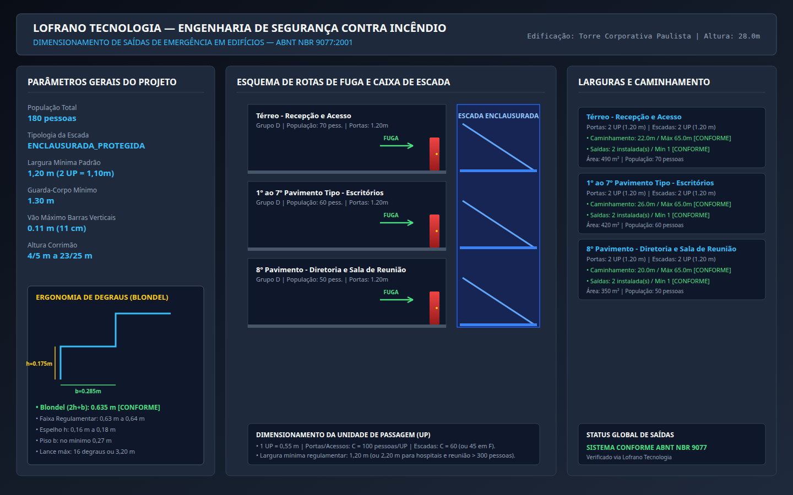
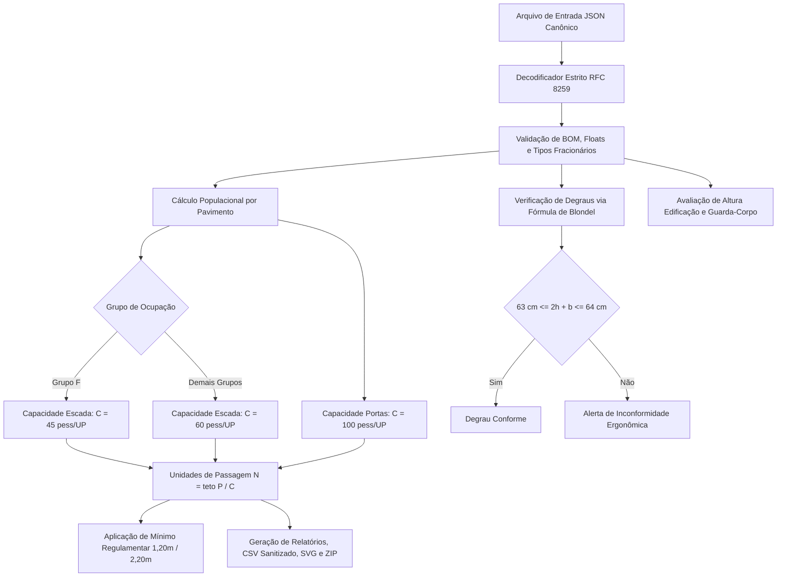

# Dimensionamento de Saídas de Emergência em Edifícios (ABNT NBR 9077:2001)

[](https://github.com/martinlofranodeoliveira/dimensionamento-saidas-emergencia-nbr9077/actions/workflows/ci.yml)
[](https://www.python.org/)
[](https://www.abnt.org.br/)
[-success.svg)]()
[-brightgreen.svg)]()
[](LICENSE)

Sistema computacional de alta confiabilidade para projeto, cálculo populacional e dimensionamento de rotas de fuga, portas, corredores, escadas de emergência, rampas e parâmetros ergonômicos de degraus segundo os requisitos e critérios técnicos da norma brasileira **ABNT NBR 9077:2001** (*Saídas de emergência em edifícios*) e legislações de segurança contra incêndio e pânico dos Corpos de Bombeiros Militares.

Desenvolvido sob os rigorosos padrões de excelência de engenharia da **LOFRANO TECNOLOGIA**: 100% em português brasileiro, dependência zero de pacotes externos (utilizando exclusivamente a biblioteca padrão do Python), aritmética racional exata via `fractions.Fraction` (proibição total de ponto flutuante IEEE-754 em cálculos de população, unidades de passagem, larguras e Blondel) e empacotamento determinístico.

---

## Painel Esquemático de Engenharia

O módulo inclui gerador vetorial SVG integrado e renderização gráfica em alta resolução (1440x900) contendo o esquema estrutural de rotas de fuga, corte esquemático da caixa de escada enclausurada, fluxo direcional de escape, portas corta-fogo e detalhe dimensional de piso e espelho com cotas ergonômicas de Blondel:



---

## Fundamentação Normativa e Física (ABNT NBR 9077:2001)

### 1. Unidade de Passagem (UP) e Capacidade de Escoamento ($C$)
A capacidade de escoamento das saídas de emergência é baseada na **Unidade de Passagem (UP)**, que corresponde à largura mínima necessária para a passagem de uma fila de pessoas em fila indiana:

$$1\text{ UP} = 0{,}55\text{ m}$$

A quantidade de unidades de passagem ($N$) necessárias para portas ou escadas é dada pela razão entre a população do pavimento ($P$) e a capacidade da unidade de passagem ($C$):

$$N = \left\lceil \frac{P}{C} \right\rceil$$

Onde as capacidades normativas de escoamento $C$ por UP são:

| Elemento de Saída | Ocupação / Destinação | Capacidade ($C$) [pessoas / UP] |
| :--- | :--- | :---: |
| **Portas, acessos e corredores horizontais** | Todos os grupos de ocupação (A a J) | **100** |
| **Escadas e rampas em geral** | Grupos A, B, C, D, E, G, H, I, J | **60** |
| **Escadas e rampas em locais de reunião** | Grupo F (cinemas, teatros, estádios, clubes) | **45** |

A largura mínima calculada em metros é dada por:

$$L = \max\left(L_{\text{mínimo,normativo}}, N \times 0{,}55\text{ m}\right)$$

### 2. Larguras Mínimas Regulamentares
Mesmo para populações reduzidas, a NBR 9077 estipula larguras mínimas invioláveis para garantir o trânsito seguro em evacuação rápida:

- **Padrão Geral de Edificações**: $1{,}20\text{ m}$ (correspondente a 2 UP arredondadas normativamente).
- **Hospitais, Clínicas com Internação e Prontos-Socorros (Grupo H)**: $2{,}20\text{ m}$ em corredores e portas para passagem simultânea de macas, leitos e equipes médicas.
- **Locais de Reunião de Público (Grupo F)**: $2{,}20\text{ m}$ quando a população total do setor exceder 300 pessoas.

### 3. Ergonomia e Segurança de Degraus (Fórmula de Blondel)
Para evitar tropeços, quedas e garantir o ritmo biológico natural de marcha na fuga, todos os degraus de escadas devem atender rigorosamente à **Fórmula de François Blondel**:

$$63{,}0\text{ cm} \le (2h + b) \le 64{,}0\text{ cm}$$

Com os limites geométricos individuais:
- **Altura do Espelho ($h$)**: $16{,}0\text{ cm} \le h \le 18{,}0\text{ cm}$ ($0{,}16\text{ m} \le h \le 0{,}18\text{ m}$).
- **Largura do Piso ($b$)**: $b \ge 27{,}0\text{ cm}$ ($b \ge 0{,}27\text{ m}$).
- **Lances de Escada**: mínimo de 3 degraus e máximo de 16 degraus por lance, exigindo patamar intermediário a cada no máximo $3{,}20\text{ m}$ de desnível vertical. O comprimento do patamar deve ser no mínimo igual à largura da escada.

### 4. Guarda-Corpos e Corrimãos
- **Altura de Guarda-Corpo**:
  - Edificações com desnível de até $12{,}0\text{ m}$: altura mínima de **$1{,}05\text{ m}$**.
  - Edificações com desnível superior a $12{,}0\text{ m}$: altura mínima de **$1{,}30\text{ m}$**.
- **Vão Livre Máximo**: espaçamento livre entre barras verticais não superior a **$11{,}0\text{ cm}$** ($0{,}11\text{ m}$), vedada terminantemente a utilização de barras horizontais escaláveis.
- **Corrimãos**: posicionados a uma altura entre **$0{,}80\text{ m}$** e **$0{,}92\text{ m}$** acima do nível do degrau.
- **Corrimão Intermediário Central**: obrigatório em qualquer escada cuja largura útil calculada supere **$2{,}20\text{ m}$**.

### 5. Distâncias Máximas a Percorrer (Caminhamento até Saída Segura)
A distância máxima que um ocupante percorre do ponto mais desfavorável até a porta de acesso à escada protegida ou espaço livre exterior é limitada conforme a Tabela 2 da NBR 9077:

| Configuração de Saídas | Sem Chuveiros Automáticos | Com Chuveiros Automáticos (Sprinklers) |
| :--- | :---: | :---: |
| **Saída Única** | Até **$30{,}0\text{ m}$** | Até **$45{,}0\text{ m}$** |
| **Mais de Uma Saída Distinta** | Até **$45{,}0\text{ m}$** | Até **$65{,}0\text{ m}$** |

---

## Fluxo Lógico e Arquitetura do Sistema



---

## Instalação e Execução

### Requisitos
- **Python 3.11 ou superior** (testado e certificado em Python 3.11, 3.12, 3.13 e 3.14).
- Sistema operacional Linux, macOS ou Windows.
- **Zero dependências externas**: opera 100% com a biblioteca padrão (`fractions`, `json`, `csv`, `zipfile`, `os`, `sys`, `dataclasses`, `argparse`).

### Instalação via Clone ou Wheel
```bash
git clone https://github.com/martinlofranodeoliveira/dimensionamento-saidas-emergencia-nbr9077.git
cd dimensionamento-saidas-emergencia-nbr9077
python3 -m pip install .
```

---

## Interface de Linha de Comando (CLI)

O pacote disponibiliza o comando `saidas-nbr9077` (ou via módulo `python3 -m saidas_nbr9077.cli`):

```bash
# Exibir parâmetros normativos da NBR 9077
saidas-nbr9077 catalogo

# Gerar arquivo JSON modelo para preenchimento
saidas-nbr9077 gerar-exemplo --saida meu_projeto.json

# Dimensionar saídas gerando memorial técnico em texto
saidas-nbr9077 calcular examples/edificio_corporativo_escritorios.json

# Exportar resultados em JSON canônico sem ponto flutuante
saidas-nbr9077 calcular examples/edificio_corporativo_escritorios.json --formato json --saida relatorio.json

# Exportar resumo tabular em CSV sanitizado contra injeção de fórmulas
saidas-nbr9077 calcular examples/edificio_corporativo_escritorios.json --formato csv --saida resumo.csv

# Gerar diagrama vetorial SVG completo
saidas-nbr9077 calcular examples/edificio_corporativo_escritorios.json --formato svg --saida painel.svg

# Gerar pacote ZIP determinístico completo com memorial, JSON, CSV e SVG
saidas-nbr9077 calcular examples/edificio_corporativo_escritorios.json --pacote-zip dist/pacote_completo.zip
```

---

## Exemplo de Uso via API Python

```python
from fractions import Fraction
from saidas_nbr9077 import (
    DadosDegrau,
    DadosEdificacao,
    DadosPavimento,
    GrupoOcupacao,
    TipoEscada,
    dimensionar_saidas_edificacao,
    gerar_relatorio_texto,
)

# Definição dos dados da edificação em frações exatas
edificacao = DadosEdificacao(
    nome_edificacao="Centro Executivo Lofrano",
    altura_total_m=Fraction(24, 1),
    tipo_escada=TipoEscada.ENCLAUSURADA_PROTEGIDA,
    possui_sprinklers=True,
    dados_degrau=DadosDegrau(
        altura_espelho_m=Fraction(175, 1000),  # 17.5 cm
        largura_piso_m=Fraction(280, 1000),    # 28.0 cm (Blondel = 63.0 cm)
    ),
    pavimentos=(
        DadosPavimento(
            nome_pavimento="Térreo - Hall Principal",
            grupo_ocupacao=GrupoOcupacao.D_SERVICOS_PROFISSIONAIS,
            area_liquida_m2=Fraction(400, 1),
            distancia_percorrer_m=Fraction(22, 1),
            quantidade_saidas_instaladas=2,
        ),
        DadosPavimento(
            nome_pavimento="Pavimentos Tipo 1 ao 6",
            grupo_ocupacao=GrupoOcupacao.D_SERVICOS_PROFISSIONAIS,
            area_liquida_m2=Fraction(350, 1),
            distancia_percorrer_m=Fraction(25, 1),
            quantidade_saidas_instaladas=2,
        ),
    ),
)

# Cálculo e dimensionamento das saídas de emergência
resultado = dimensionar_saidas_edificacao(edificacao)

print(f"População Total: {resultado.populacao_total_edificacao} pessoas")
print(f"Fórmula de Blondel: {resultado.degraus.valor_blondel_m} m -> Conforme: {resultado.degraus.conforme_blondel}")
print(f"Guarda-Corpo Mínimo: {resultado.guarda_corpo.altura_minima_guarda_corpo_m} m")

# Emissão do memorial descritivo completo
memorial = gerar_relatorio_texto(resultado)
print(memorial)
```

---

## Estrutura do Repositório

```
dimensionamento-saidas-emergencia-nbr9077/
├── .github/workflows/ci.yml       # Multiplataforma (Linux 3.11-3.14, Windows 3.14)
├── docs/
│   ├── exemplo.png                # Renderização vetorial 1440x900 em alta resolução
│   └── painel_exemplo.svg         # SVG com corte esquemático e detalhes de escape
├── examples/
│   ├── edificio_corporativo_escritorios.json
│   ├── escola_educacional_salas.json
│   └── teatro_reuniao_publico.json
├── scripts/
│   ├── check_distribution.py     # Auditor estrito de pacotes sdist e wheel
│   └── generate_assets.py        # Renderizador de SVG e automação headless Chrome
├── src/
│   └── saidas_nbr9077/
│       ├── __init__.py            # Versão 1.0.0 e exports públicos
│       ├── calculator.py          # Lógica de cálculo populacional, UP, larguras e Blondel
│       ├── cli.py                 # Interface de linha de comando completa
│       ├── codecs.py              # Parser JSON canônico RFC 8259 sem float
│       ├── constants.py           # Constantes e coeficientes da ABNT NBR 9077:2001
│       ├── exporters.py           # Memorial descritivo, CSV sanitizado e ZIP determinístico
│       ├── models.py              # Dataclasses tipadas e imutáveis
│       ├── py.typed               # Marcação de tipagem estrita PEP 561
│       └── svg_generator.py       # Gerador gráfico vetorial com corte esquemático
├── tests/
│   ├── test_calculator.py         # Testes de dimensionamento e Blondel
│   ├── test_casos_avancados.py    # Testes aprofundados (hospitais, teatros, corrimão central)
│   ├── test_cli.py                # Testes de execução da CLI
│   ├── test_codecs.py             # Testes de parser JSON, rejeição de floats e BOM
│   ├── test_constants.py          # Validação de coeficientes normativos
│   ├── test_exporters.py          # Testes de memorial, CSV sanitizado e ZIP
│   ├── test_models.py             # Testes de validação de dataclasses
│   └── test_svg.py                # Testes de integridade da saída gráfica vetorial
├── tools/
│   └── verify_independent.py      # Auditor independente SQLite em memória
├── LICENSE                        # Licença MIT - Lofrano Tecnologia 2026
├── pyproject.toml                 # Configuração de build determinístico PEP 621
└── README.md                      # Documentação técnica completa
```

---

## Verificação e Auditoria Independente (SQLite em Memória)

Para certificar a confiabilidade dos cálculos de maneira desacoplada do código de produção, o repositório inclui a ferramenta independente `tools/verify_independent.py`. O script utiliza um banco de dados SQLite relacional em memória com fórmulas SQL puras e aritmética de frações autônoma para auditar os cenários de teste:

```bash
python3 tools/verify_independent.py
```

---

## Padrões de Engenharia da Lofrano Tecnologia

1. **Aritmética Racional Exata**: Ausência completa de tipos `float` em grandezas físicas, populacionais e ergonômicas, eliminando imprecisões de arredondamento IEEE-754.
2. **Segurança de Entrada RFC 8259**: Rejeição expressa de floats soltos no JSON, Byte Order Mark (`\xef\xbb\xbf`), chaves duplicadas e estruturas cíclicas profundas (> 32 níveis).
3. **Proteção contra Injeção de Planilhas**: Campos de texto exportados em CSV são sanitizados contra caracteres perigosos (`=`, `+`, `-`, `@`, `\t`, `\r`).
4. **Empacotamento Determinístico**: Arquivos ZIP gerados com a flag `os.O_EXCL` (prevenindo sobrescrita) e carimbo de data/hora fixo (`2026-01-01 00:00:00`).
5. **Automação Contínua (CI)**: Pipeline do GitHub Actions testado em Linux e Windows com isolamento de rede (`unshare -r -n`).

---

## Licença

Distribuído sob a licença **MIT**. Consulte o arquivo [LICENSE](LICENSE) para obter mais informações.

Copyright (c) 2026 Lofrano Tecnologia. Todos os direitos reservados.
